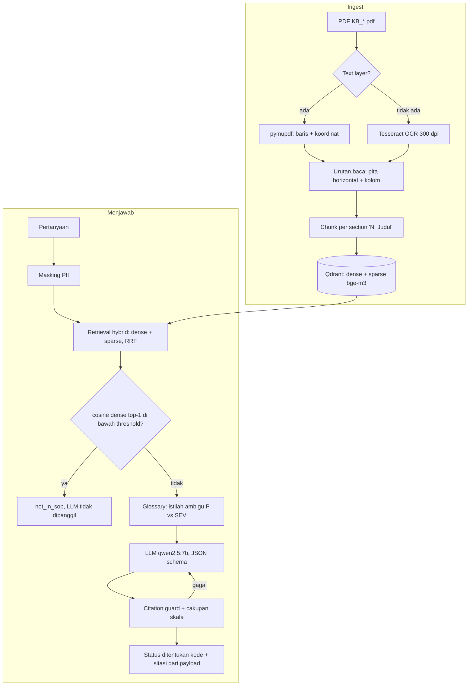

# SOP Assistant

Proof of concept asisten tanya-jawab untuk dokumen SOP berbentuk PDF. Jawaban disusun hanya dari isi SOP, setiap klaim bisa ditelusuri ke dokumen, halaman, dan section, dan pertanyaan di luar cakupan dijawab terus terang sebagai "tidak ada di SOP". Semua komponen (OCR, embedding, Qdrant, LLM) berjalan lokal di Mac Apple Silicon; data SOP tidak keluar dari mesin.

**Persona:** petugas layanan shift yang dikejar SLA (tiket P1 harus direspons dalam 15 menit). Ia butuh jawaban ringkas dan langsung, status yang jelas (boleh dipakai, perlu dicek, atau memang tidak diatur), dan sumber yang bisa diverifikasi dalam hitungan detik. Karena itu status selalu tampil di baris pertama, dan nama dokumen, halaman, serta cuplikan sumber diambil oleh kode dari indeks, bukan ditulis oleh LLM.

```
$ make ask Q="Gangguan kritis harus di-update tiap berapa menit?"
 PERLU DITINJAU  Istilah di pertanyaan bisa merujuk ke dua skala berbeda. Pastikan klasifikasinya sebelum bertindak.
Kemungkinan maksud "gangguan kritis": P1 Kritis (prioritas tiket, KB_01 §3) | SEV1 (tingkat insiden, KB_04 §2)

Gangguan kritis SEV1 harus di-update setiap 20 menit untuk status internal. Tiket P1 diperbarui setidaknya
setiap 30 menit selama gangguan aktif. ...

Sumber
  KB_04 Eskalasi dan Penanganan Insiden, hal. 1, §5 Komunikasi Insiden
    "Untuk SEV1, pembaruan status internal dibuat setiap 20 menit. ..."
  KB_03 Panduan Operasional Layanan, hal. 1, §1 Jam Layanan
  KB_04 Eskalasi dan Penanganan Insiden, hal. 1, §3 Aktivasi Eskalasi
  KB_03 Panduan Operasional Layanan, hal. 1, §4 Pembaruan Berkala
    "Tiket P1 diperbarui kepada pelanggan setidaknya setiap 30 menit selama gangguan aktif. ..."

dense top-1 0.653 | retrieval 292 ms | LLM 18489 ms (1x perbaikan) | total 18782 ms | muat model 6.9 dtk
```

Output asli, cuplikan dipersingkat. §1 dan §3 ikut disitasi walau tidak menjawab pertanyaan; lihat [Evaluasi](#evaluasi).

## Daftar isi

1. [Cara menjalankan](#cara-menjalankan)
2. [Arsitektur](#arsitektur)
3. [Keputusan teknis](#keputusan-teknis)
4. [Penanganan dua kolom](#penanganan-dua-kolom)
5. [Evaluasi](#evaluasi)
6. [Keterbatasan](#keterbatasan)
7. [Sudah dibangun vs rencana](#sudah-dibangun-vs-rencana)
8. [Prioritas perbaikan](#prioritas-perbaikan)

## Cara menjalankan

**Prasyarat** (diuji di MacBook Pro M5, RAM 24 GB):

- [uv](https://docs.astral.sh/uv/) (Python 3.12 dipasang otomatis lewat `.python-version`)
- Docker Desktop, untuk server Qdrant (opsional, lihat mode embedded di bawah)
- [Ollama](https://ollama.com) dengan model `qwen2.5:7b`
- Tesseract + bahasa Indonesia: `brew install tesseract tesseract-lang`

```bash
make setup        # .venv Python 3.12, dependency, .env dari .env.example
make models       # unduh bge-m3 (sekitar 2.3 GB) dan qwen2.5:7b, sekali saja
make qdrant-up    # Qdrant v1.19.2 di localhost
make smoke        # cek Tesseract, Qdrant, bge-m3, Ollama
make ingest       # ekstrak PDF -> data/chunks.jsonl -> index Qdrant (aman dijalankan ulang)
make test         # unit test + integrasi (integrasi di-skip jika Qdrant mati)

make ask Q="Kalau pelanggan tidak merespons, kapan tiket boleh ditutup?"
uv run sop ask "..." --json        # hasil lengkap: klaim, hasil guard, alasan perbaikan
make chat         # mode interaktif: model dimuat sekali, tahap proses tampil saat menjawab

make calibrate    # pilih threshold abstain -> eval/calibration.json
make eval         # evaluasi hybrid -> eval/results/hybrid.json + eval/report.md
make eval-ablation  # dense-only dan baseline full-context, kolom tambahan di report
make demo         # pertanyaan demo -> demo/demo_output.md
```

`make help` menampilkan semua target. Target lain: `make search Q="..."` (debug retrieval tanpa LLM), `make check-pdfs` (PDF mana yang perlu OCR), `make before-after` (bahan bagian dua kolom).

**Tanpa Docker.** Kosongkan `QDRANT_URL=` di `.env`. Qdrant berjalan embedded dengan kode dan Query API yang sama, data di `data/qdrant_local/`.

**Tanpa Mac / tanpa Ollama.** Set di `.env`:

```bash
LLM_ENGINE=openai_compat
OPENAI_BASE_URL=http://localhost:1234/v1   # LM Studio, vLLM, atau provider OpenAI-compatible
OPENAI_MODEL=nama-model
OPENAI_API_KEY=                            # jika diperlukan
```

`OpenAICompatEngine` mengirim JSON schema lewat `response_format`; jika provider menolak, otomatis kembali ke `json_object` dengan skema di prompt. Embedding bge-m3 berjalan di CPU pada Linux. Tesseract di Debian/Ubuntu: `apt install tesseract-ocr tesseract-ocr-ind`.

**Offline.** Setelah `make models`, tidak ada komponen yang butuh internet: model embedding dibaca dari cache lokal lebih dulu, Ollama dan Qdrant berjalan di localhost (port hanya di-bind ke `127.0.0.1`, telemetri Qdrant dimatikan). `HF_HUB_OFFLINE=1` di `.env` menjamin tidak ada pengecekan ke HuggingFace.

## Arsitektur



Hanya kotak "LLM" yang memakai model generatif. Semua keputusan lain (abstain, ambiguitas, verifikasi sitasi, status akhir) adalah aturan yang dites di `tests/`. Perbaikan dibatasi satu kali.

| Modul | Isi |
|---|---|
| `extract.py` | text layer atau OCR, urutan baca, cleanup, potong per section |
| `index.py`, `retrieve.py` | koleksi Qdrant hybrid, upsert idempoten, RRF, dense top-1 untuk abstain |
| `guards.py` | masking PII, abstain, glossary, citation guard (angka, satuan, pasangan angka-level), cakupan skala, aturan eskalasi |
| `engines.py` | `LLMEngine` protocol: `OllamaEngine`, `OpenAICompatEngine`, `FakeEngine` |
| `prompts.py`, `answer.py` | prompt, skema output, pipeline, penentuan status, kabar tahap proses |
| `session.py` | `Assistant`: model dimuat sekali, dipakai `sop ask` dan `sop chat` |
| `evaluation.py` | metrik per tahap, baseline, laporan |

## Keputusan teknis

### Prinsip dari project sebelumnya

| Prinsip | Asal | Implementasi di repo ini |
|---|---|---|
| Reliability states | Malokit (status MOCDO: reliable / needs review / not calculable) | Setiap jawaban berstatus `answered`, `needs_review` (partial, ambiguous, conflict, guard_failed), atau `not_in_sop`. Status akhir ditentukan kode. |
| Golden dataset + eval per tahap, chunking berbasis struktur | Gani.ai (chunking per pasal, bge-m3) | Chunk per section bernomor. Eval terpisah untuk ekstraksi (CER), retrieval (recall@5, MRR), dan jawaban. |
| Deterministik dulu, LLM untuk sintesis | Sena (model kecil lemah dalam memilih dan menalar) | Abstain, ambiguitas, citation guard, cakupan skala, dan status adalah aturan. LLM hanya menyusun klaim dan jawaban. |
| Pluggable engine | Malokit (`AnalysisEngine` protocol) | `LLMEngine` protocol dengan tiga implementasi. Pipeline dites dengan `FakeEngine` tanpa LLM. |
| Manusia memegang keputusan | Tata | Prompt meminta arahan ke pihak yang disebut SOP (`escalate_to`). Model sering mengosongkannya (q14, q15, q16), jadi untuk kompensasi dan kebocoran data kode mengisinya dari [`escalation.yaml`](escalation.yaml) dan menandainya "diisi aturan eskalasi". |
| Honest representation | AI-Moris | Bagian "Sudah dibangun vs rencana", dan kegagalan eval dilaporkan apa adanya. |
| User-first | Malokit, Gani.ai | Status di baris pertama, sumber dengan cuplikan verbatim, latensi model dan latensi menjawab dipisah. |

### Kenapa tidak memakai agent loop

- Korpus 32 chunk; satu kali retrieval sudah mengambil chunk yang benar (recall@5 = 1.00), jadi tidak ada yang perlu "dicari ulang" oleh agent.
- Model 7B lemah dalam memilih tool dan menalar multi-langkah (pelajaran dari Sena). Di repo ini pun model menjawab satu skala saja meski diminta dua (q10), dan memenuhi aturan dengan menyitasi section yang tidak relevan. Agent loop menambah titik keputusan yang sama rapuhnya.
- Setiap panggilan LLM lokal 4-7 detik. Satu jawaban + maksimal satu perbaikan bisa diprediksi latensinya; loop tidak.
- Alur tetap lebih mudah dievaluasi: setiap tahap punya metrik sendiri.

### Keputusan per tahap

**Ekstraksi**
- **Tesseract, bukan VLM atau MinerU.** Deterministik, memberi koordinat per baris (wajib untuk urutan kolom), dan bisa dijalankan reviewer di OS apa pun. Apple Vision lebih akurat tetapi hanya di Mac; VLM (`qwen3-vl`) tidak memberi bbox yang andal dan bisa mengarang teks.
- **Satu representasi `Line` untuk text layer dan OCR.** Koordinat OCR dikonversi ke point PDF, sehingga satu algoritma urutan baca dan satu `bbox` berlaku untuk keempat dokumen.
- **Heading diterima hanya jika nomornya tepat nomor sebelumnya + 1.** Menahan noise OCR dan baris isi yang kebetulan diawali angka ("09.00-17.00").
- **Koreksi OCR khusus token level.** Tesseract membaca `SEV1` sebagai `SEVI`. Karena token level punya format pasti (SEV1-4, P1-4), `I`/`l`/`|` setelah `SEV`/`P` dikoreksi ke `1`, hanya pada teks OCR.

**Indexing dan retrieval**
- **bge-m3 dense + sparse dalam satu forward pass.** Sparse menangkap token persis (`SEV2`, `P1`) yang penting untuk pertanyaan informal.
- **Abstain memakai cosine dense top-1, bukan skor RRF.** Skor RRF di Qdrant terlihat seperti skor 0-1 tetapi hanya mencerminkan peringkat: 0.833 = 1/2 + 1/3 (peringkat 1 di satu daftar, 2 di daftar lain).
- **Ingest idempoten.** Point ID adalah UUID5 dari `chunk_id`; chunk dengan `content_hash` sama tidak di-embed ulang. Ingest kedua: 0 di-embed, 1.8 detik.

**Menjawab**
- **Skema JSON membatasi `chunk_ids` ke daftar chunk di konteks** (enum), sehingga Ollama tidak bisa mengarang ID. Urutan field: klaim bersumber ditulis dulu, status diputuskan terakhir.
- **Citation guard membedakan satuan.** "4 jam" tidak lolos jika sumbernya "4 jam kerja"; "dua hari kerja" = "2 hari kerja". Angka di teks jawaban juga dicek, bukan hanya di klaim, karena teks itulah yang dibaca petugas.
- **Citation guard memeriksa pasangan angka dan level.** Setiap angka di sumber dicatat milik level yang mendahuluinya ("P1: 15 menit; P2: 1 jam" -> 15 menit milik P1; "Untuk SEV1 dan SEV2, ... lima hari kerja" -> milik keduanya). Klaim "SEV1 setiap 30 menit" ditolak karena di KB_03 §4 30 menit milik P1. Sengaja konservatif: kalimat bernegasi dilewati (koreksi premis "P3 tidak perlu 4 jam kerja" sah) dan angka yang berlaku umum tidak diperiksa.
- **Eskalasi diisi aturan, status tidak diubah.** Menurunkan status ke `partial` untuk semua topik sensitif akan membuat q14/q15 lolos, tetapi salah untuk pertanyaan yang memang terjawab penuh (q08 tentang OTP). Itu menyetel aturan demi skor, jadi tidak dilakukan.
- **Cakupan skala untuk istilah ambigu.** Jika glossary mendeteksi "gangguan kritis", harus ada klaim yang menyebut `P1` dengan sitasi dokumen skala P, dan klaim yang menyebut `SEV1` dengan sitasi KB_04. Versi pertama hanya mengecek dokumen, dan model memenuhinya dengan menyitasi KB_03 §1 (yang kebetulan memuat "gangguan kritis") tanpa menjawab P1.
- **Urutan status:** guard gagal > `not_in_sop` dari LLM > ambiguitas dari glossary > status dari LLM. Penyimpangan dari brief: `not_in_sop` dipertahankan meski ada istilah ambigu, karena "berapa tunjangan saat gangguan kritis?" tetap di luar SOP.
- **Glossary dicocokkan per frasa.** "sedang" juga berarti *currently* ("tiket yang sedang diproses") dan "tinggi" adalah kata umum; keduanya punya test negatif.

### Temuan saat membangun (asumsi awal yang ternyata salah)

| Asumsi | Kenyataan | Dampak |
|---|---|---|
| Text di PDF bisa di-select, berarti ada text layer | KB_01 dan KB_04 hanya berisi gambar 1012×1432 px (sekitar 122 DPI). Teks bisa di-select karena macOS Live Text meng-OCR saat dibuka. | OCR jadi jalur kritis, bukan fallback |
| KB_03 satu kolom sempit | KB_03 juga dua kolom (§1-6 kiri, §7-8 kanan), dengan text layer | Kasus dua kolom kedua, dari sumber berbeda |
| Aturan "blok > 60% lebar = full-width, taruh di atas" | Di dokumen satu kolom, isi section lebar tetapi heading sempit: semua isi terbaca sebelum semua heading | Diganti algoritma pita (lihat bawah) |
| Test urutan kolom KB_03 cukup memakai urutan stream | Urutan stream KB_03 kebetulan sudah benar | Test mengacak urutan blok lebih dulu |
| CER rendah = ekstraksi aman | CER 0.11% tetapi `SEV1` terbaca `SEVI`, satu karakter yang mengubah makna | Ditambah test token kritis |

## Penanganan dua kolom

Halaman dipotong menjadi pita horizontal oleh baris yang **melintasi garis tengah halaman** (x0 < tengah < x1), karena baris seperti itu pasti teks selebar halaman. Di dalam tiap pita, kolom kiri dibaca dari atas ke bawah, lalu kolom kanan. Satu aturan ini benar untuk KB_01 (dua kolom, OCR), KB_03 (dua kolom, text layer), dan KB_02/KB_04 (satu kolom dengan heading sempit).

KB_01 tanpa penanganan: `page.get_text()` mengembalikan **0 karakter**. Hasil OCR yang dibaca per baris visual dari kiri ke kanan mencampur §1 dan §7:

```text
Penanganan Tiket Layanan
1. Tujuan 7. Penutupan
Panduan ini digunakan oleh petugas layanan untuk Tiket dapat ditutup setelah penyelesaian
menerima, mengelompokkan, menangani, dan dikonfirmasi pelanggan atau setelah dua hari kerja
```

Sesudah urutan kolom dan potong per section:

```text
doc_title: Penanganan Tiket Layanan
1. Tujuan: Panduan ini digunakan oleh petugas layanan untuk menerima, mengelompok...
...
6. Status Tiket: Status yang digunakan adalah Baru, Diproses, Menunggu Pelanggan, Menun...
7. Penutupan: Tiket dapat ditutup setelah penyelesaian dikonfirmasi pelanggan atau s...
8. Catatan Khusus: Apabila ada indikasi kebocoran data, jangan mencantumkan informasi rah...
```

Contoh lengkap (termasuk KB_03, yang nomor halamannya "1" menempel setelah judul di urutan stream) ada di [`docs/two_column_before_after.md`](docs/two_column_before_after.md), di-generate dari PDF asli dengan `make before-after`. Test di [`tests/test_extract.py`](tests/test_extract.py) memastikan section 1-8 berurutan di setiap dokumen dan KB_01 §1 tidak memuat isi §7/§8.

## Evaluasi

Golden set 21 pertanyaan ([`eval/golden.yaml`](eval/golden.yaml)): faktual, pengecualian, multi-hop, ambigu, premis salah, parsial, hard negative di luar cakupan, informal, dan prompt injection. Laporan lengkap per pertanyaan: [`eval/report.md`](eval/report.md). Demo terformat: [`demo/demo_output.md`](demo/demo_output.md).

### Ringkasan metrik

Angka setelah perbaikan guard (pasangan angka-level dan eskalasi); perbandingan dengan sebelum perbaikan ada di bawah.

| Metrik | hybrid | dense (ablation) | full-context (baseline) |
|---|---|---|---|
| Lolos keseluruhan | 16/21 (76%) | 16/21 (76%) | 16/21 (76%) |
| Akurasi status | 19/21 (90%) | 19/21 (90%) | 18/21 (86%) |
| Ketepatan sitasi (in-scope) | 17/18 (94%) | 17/18 (94%) | 16/18 (89%) |
| `must_include` terpenuhi | 16/18 (89%) | 16/18 (89%) | 16/18 (89%) |
| Recall@5 retrieval | 1.00 | 1.00 | - |
| MRR retrieval | 0.97 | 1.00 | - |
| Guard lolos percobaan pertama | 19/20 (95%) | 19/20 (95%) | 20/21 (95%) |
| Guard gagal setelah perbaikan | 0 | 0 | 1 (q10) |
| Out-of-scope ditolak threshold | 1/3 | 1/3 | 0/3 (tidak ada threshold) |
| In-scope salah abstain | 0 | 0 | 0 |
| Latensi total p50 / p95 | 6.1 / 10.2 dtk | 6.1 / 11.5 dtk | 5.9 / 11.9 dtk |

Ekstraksi: 32 chunk, section 1-8 di keempat dokumen, CER OCR 0.18% (KB_01) dan 0.11% (KB_04) terhadap transkripsi manual. Threshold abstain 0.460 ([`eval/calibration.json`](eval/calibration.json)).

### Yang berjalan

- **Ketiga pertanyaan di luar cakupan dijawab `not_in_sop`**, tanpa ada pertanyaan in-scope yang ikut ditolak. q18 ditolak threshold sebelum LLM dipanggil; q16 dan q17 ditolak lapisan LLM.
- **Istilah ambigu** (q10, q11) berstatus `needs_review/ambiguous`, dengan kedua skala disebut. Di q10 status itu datang dari glossary, dan cakupan skala memaksa satu kali perbaikan karena jawaban pertama hanya membahas SEV1.
- **Pengecualian dan premis salah** (q07, q13), **bahasa informal** (q19, q20), dan **prompt injection** (q21) terjawab benar dengan sumber yang tepat.
- **Di mode hybrid tidak ada jawaban yang gagal guard setelah perbaikan**, dan cek pasangan angka-level tidak menolak satu pun jawaban yang benar.

### Yang gagal atau kurang akurat

| ID | Masalah | Jenis |
|---|---|---|
| q04 | Jawaban menghilangkan batasan "untuk SEV1 dan SEV2" | Syarat berlaku hilang |
| q09 | Hanya menyitasi KB_04 §7; KB_01 §7 (aturan penutupan) ada di peringkat 2 tetapi tidak dipakai | Multi-hop tidak lengkap |
| q12 | Tidak menyebut bahwa keluhan berulang ditinjau koordinator | Jawaban tidak lengkap |
| q14, q15 | Model menjawab `answered`, seharusnya `partial`. `escalate_to` dikosongkan model; sekarang diisi aturan eskalasi, tetapi status tetap salah | Kalibrasi status |

Masalah yang **lolos metrik** tetapi tetap salah:

- **q16:** "tidak boleh menjanjikan pengembalian dana **melalui e-wallet**". KB_02 §7 tidak menyebut e-wallet; model menempelkan kata dari pertanyaan ke aturan SOP sehingga SOP tampak mengatur e-wallet.
- **q11:** "P2 juga harus **segera ditangani**". Tidak ada di SOP, tetapi lolos guard karena tidak memuat angka.
- **q17:** status `not_in_sop` yang benar, tetapi menampilkan lima sumber yang tidak relevan.
- **Demo PII** (di luar golden set): kode OTP berhasil disamarkan, tetapi jawabannya "tidak boleh **menggunakan** kode OTP yang dikirim pelanggan". KB_02 §2 hanya melarang **meminta** OTP; untuk OTP yang dikirim pelanggan, SOP hanya mensyaratkan data sensitif disamarkan sebelum bukti percakapan dilampirkan. Terdengar aman, tetapi melampaui sumber.

### Temuan dari perbandingan

1. **Hybrid tidak lebih baik dari dense di korpus ini.** Keduanya recall@5 = 1.00; dense malah sedikit lebih baik di MRR (q05). Dengan 32 chunk, retrieval belum benar-benar diuji; manfaat sparse untuk token persis belum terukur.
2. **Baseline full-context sama skornya, tetapi membuat kesalahan yang lebih berbahaya.** Di q10 baseline menjawab "SEV1 diperbarui setiap **30 menit**" (benar: 20 menit). Guard versi pertama meloloskannya karena angka 30 menit memang ada di chunk yang disitasi (KB_03 §4, untuk P1); hanya `must_include` di eval yang menangkapnya. Retrieval yang memberi konteks lebih sempit membuat model 7B lebih sedikit tertukar; full-context juga tidak bisa menolak pertanyaan sebelum LLM.
3. **Threshold saja tidak cukup.** q19 (in-scope, informal "brp lama sev2 hrs dieskalasi") skornya 0.502, lebih rendah dari q16 (0.514) dan q17 (0.508) yang di luar cakupan. Lapisan kedua (LLM + guard) wajib ada.
4. **Di run pertama guard tidak menangkap satu pun kesalahan nyata.** Kesalahan yang muncul berupa hal yang dihilangkan, angka yang dipasangkan ke level yang salah, dan kata yang ditambahkan, sedangkan guard hanya mengecek angka dan satuan. Ini yang mendorong perbaikan di bawah.

### Sebelum vs sesudah perbaikan

Dua perbaikan diambil dari temuan di atas: cek pasangan angka-level (temuan 2) dan eskalasi deterministik (q14/q15). LLM berjalan dengan `temperature=0, seed=0`; di full-context q10 sitasinya identik dengan run sebelumnya, jadi perbedaan hasil datang dari guard, bukan dari model.

| Kasus | Sebelum | Sesudah |
|---|---|---|
| Full-context q10 | "SEV1 diperbarui setiap 30 menit" (salah) tampil ke pengguna sebagai `needs_review/ambiguous` | Klaim itu ditolak guard; status `needs_review/guard_failed`, hanya klaim terverifikasi yang ditampilkan |
| q14, q15, q16 | `escalate_to` kosong | Diisi dari SOP (KB_02 §7; KB_04 §6 dan KB_01 §8), ditandai "diisi aturan eskalasi" |
| Hybrid, semua pertanyaan | 16/21 lolos | 16/21 lolos; tidak ada regresi, koreksi premis bernegasi (q13) tidak ikut ditolak |
| Akurasi status full-context | 19/21 | 18/21 |

Baris terakhir disengaja: metrik turun karena jawaban yang salah sekarang berstatus `guard_failed`, bukan `ambiguous`. Untuk persona ini, jawaban yang ditandai "perlu ditinjau" lebih baik daripada angka yang salah dengan status yang tampak wajar.

## Keterbatasan

- **Model lokal kecil (qwen2.5:7b).** Instruksi seperti "jawab per skala", "isi `escalate_to`", dan "status partial" tidak selalu dipatuhi. Sebagian ditegakkan kode (cakupan skala), sebagian belum (eskalasi, partial).
- **Threshold dari 21 pertanyaan**, set yang sama dengan evaluasi. Berisiko overfit; perlu kalibrasi ulang dengan pertanyaan nyata.
- **Glossary manual.** Istilah di luar daftar (misalnya "urgent", "darurat sekali") tidak terdeteksi sebagai ambigu.
- **Citation guard memeriksa angka, satuan, dan pasangan angka-level, tetapi tidak entitas lain** (e-wallet, "segera", "menggunakan"). Pasangan angka-level hanya mengenali level yang ditulis *sebelum* angka di sumber, melewati kalimat bernegasi, dan tidak memeriksa angka yang berlaku umum; "kecuali tiket P1" setelah angka tidak tertangkap.
- **Aturan eskalasi manual** ([`escalation.yaml`](escalation.yaml)), hanya dua topik yang pihak berwenangnya disebut eksplisit di SOP.
- **Korpus kecil** (4 dokumen satu halaman, 32 chunk). RAG belum diuji di skala besar, dokumen multi-halaman, atau section yang melintasi halaman (kode mencatat halaman heading saja).
- **OCR bergantung pada gambar sekitar 122 DPI.** `;` terbaca `:` di tiga tempat (misalnya KB_01 §4 "P1: 15 menit: P2: 1 jam"); tidak mengubah angka, tetapi struktur kalimat jadi rancu. Tidak dikoreksi karena tidak punya format pasti.
- **Tidak ada versioning SOP.** Jika SOP berubah, ingest menimpa chunk lama; tidak ada riwayat atau tanggal berlaku.
- **Determinisme.** `temperature=0` dan `seed=0`, tetapi output bisa sedikit berbeda antar versi Ollama atau model.
- **`sop ask` memuat model di setiap perintah** (sekitar 5-8 detik). `sop chat`, eval, dan demo memuat sekali.
- **Golden set disusun oleh pembuat sistem**, jadi bias ke kasus yang sudah terpikirkan.

## Sudah dibangun vs rencana

| Sudah dibangun | Belum / rencana |
|---|---|
| Ekstraksi text layer + OCR Tesseract, urutan baca pita + kolom, chunk per section, 35 test ekstraksi | Pembanding ekstraksi (Apple Vision, MinerU) dengan test CER dan token kritis yang sama |
| Qdrant hybrid dense + sparse bge-m3, RRF, ingest idempoten, mode embedded tanpa Docker | Uji retrieval di korpus besar, reranker |
| Masking PII, abstain dua lapis, glossary P vs SEV, citation guard (angka, satuan, pasangan angka-level), cakupan skala, eskalasi deterministik, satu kali perbaikan | Cek entitas, cek syarat berlaku yang hilang, kalibrasi status `partial` |
| `OllamaEngine` (default), `OpenAICompatEngine` (minimal), `FakeEngine` | Perbandingan model (`qwen3:8b` sudah terpasang) |
| CLI `ingest`, `search`, `ask`, `chat`, `eval`; `make demo`; kelas `Assistant` dan kabar tahap proses | Web UI demo di atas `Assistant` (halaman PDF dengan section tersorot, tahap proses lewat SSE) |
| Golden set 21 pertanyaan, kalibrasi, eval per tahap, ablation dense, baseline full-context | Golden set dari pertanyaan petugas nyata, kalibrasi ulang |

## Prioritas perbaikan

Sudah dikerjakan dari daftar awal: cek pasangan angka-level, eskalasi deterministik, dan `sop chat` (lihat [Sebelum vs sesudah](#sebelum-vs-sesudah-perbaikan)). Sisanya, berurutan:

1. **Cek kata penting.** Kata dari pertanyaan yang tidak ada di chunk sumber tidak boleh muncul di klaim (q16 "e-wallet", q11 "segera", demo PII "menggunakan").
2. **Cek syarat berlaku yang hilang.** Perluasan dari pasangan angka-level: jika angka di sumber milik level tertentu (lima hari kerja milik SEV1 dan SEV2) tetapi jawaban menyebut angka itu tanpa levelnya, minta perbaikan. Menangani q04.
3. **Kalibrasi status `partial`** (q14, q15). Coba model lain lewat `LLMEngine` (`qwen3:8b` sudah terpasang) sebelum menambah aturan, karena aturan berbasis topik terbukti salah untuk q08.
4. **Kelengkapan multi-hop** (q09): jika jawaban merujuk aturan lain ("aturan penutupan tiket") dan chunk aturan itu ada di konteks, wajib disitasi.
5. **Sumber untuk `not_in_sop`** ditampilkan sebagai "aturan terkait" atau disembunyikan (q17).
6. **Golden set lebih besar dari pertanyaan nyata** dan kalibrasi ulang threshold.
